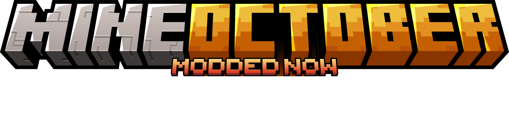

# MineOctober 2026

Фестивальная сборка Minecraft **1.21.1** (NeoForge, Sinytra Connector). Адрес сервера: **`MineOctober2026.exaroton.me`**. Он же вшит в кнопку «Играть» в главном меню сборки.

Последняя версия сборки: [Releases](https://github.com/lermanMax/mineoctober/releases/latest) (файл `Mineoctober.2026.vX.Y.Z.mrpack`).

## Как установить

### Что понадобится
- Windows, macOS или Linux, 64 бит.
- **Java 21** ([Eclipse Temurin](https://adoptium.net), JDK 21). Java 22 и новее тоже подходит.
- 8 ГБ ОЗУ или больше (под игру нужно выделить от 4 ГБ, рекомендуется 6–8 ГБ).
- Видеокарта с 2 ГБ видеопамяти и больше (на GTX 1650 4 ГБ сборка идёт нормально).
- Около 5 ГБ свободного места на диске.

### Шаги
1. **Установите Java 21** и запомните, куда она встала.
2. **Поставьте лаунчер.** Сборка проверялась в [UltimMC](https://github.com/UltimMC/Launcher) (раздел Downloading): распакуйте в отдельную папку и запустите. Подойдёт и другой лаунчер, который умеет импортировать .mrpack (формат Modrinth).
3. **Скачайте сборку:** откройте [последний релиз](https://github.com/lermanMax/mineoctober/releases/latest) → *Assets*. Два варианта:
   - **`Mineoctober.2026.….full.zip`** (≈830 МБ) — полный готовый экземпляр, **рекомендуем**: все моды и библиотеки меню (MCEF) уже внутри, ничего докачивать не нужно;
   - `Mineoctober.2026.….mrpack` (≈75 МБ) — лёгкий вариант, моды скачиваются при установке; библиотеки MCEF докачиваются при первом запуске с зарубежного сервера (в РФ может не качаться, нужен VPN/обход блокировок).
4. **Импортируйте** файл в лаунчер: *Add instance → Import from zip* (или перетащите файл в окно лаунчера).
5. **Память:** в настройках экземпляра → *Java* → максимум памяти (`-Xmx`): 8 ГБ ОЗУ в компьютере — 6144 МБ, 16 ГБ и больше — 8192 МБ. Меньше 4096 МБ ставить нельзя (игра откажется стартовать).
6. **Аккаунт.** Сервер принимает пиратские (offline) аккаунты, скин подтягивается с [ely.by](https://ely.by): зарегистрируйтесь там, выберите скин и в лаунчере добавьте учётную запись Ely.by (в поле «почта» вводится ник). Сервер понимает и обычный лицензионный аккаунт.
7. **Запустите** экземпляр. Первый запуск долгий (4–5 минут и больше): не сворачивайте окно загрузки, иначе возможен вылет. Выберите язык при первом старте.
8. В главном меню нажмите **«Играть»** или добавьте сервер вручную: `MineOctober2026.exaroton.me`.

### Обновление
Сборка обновляется часто. Для новой версии скачайте новый `.mrpack` из релизов и импортируйте его как **новый экземпляр** (старый можно удалить, миры хранятся на сервере). Версия клиента должна совпадать с версией сервера, иначе вход будет невозможен.

## Полезно знать

- **Интерфейс:** по умолчанию масштаб GUI 3x (меняется в настройках видео).
- **Дальность прорисовки на сервере — 6 чанков.** Чтобы видеть дальше, в сборке включён **Distant Horizons** (дальние «картонные» чанки до 128). Включается в *Настройки → Distant Horizons*.
- **Шейдеры** выключены по умолчанию. Включаются в *Настройки → Графика → Шейдеры* (в сборке есть BSL, Complementary, Photon и др.). Мощные шейдеры требуют сильной видеокарты, при артефактах с Distant Horizons попробуйте другой.
- **Ресурспаки:** в списке по умолчанию включены нужные для сборки. Дополнительно можно включить, например, `cubic-sun-moon` (кубические Солнце и Луна, около 150 МБ видеопамяти).
- **Профессии** (клавиша `J`), квесты (клавиша `F4`/книга заданий), титулы: есть обучающие квесты в главе «Путешествие».
- **Энд** закрыт до команды администратора (администраторы откроют его позже).
- **Голосовой чат** (Simple Voice Chat): порт UDP 24454. Если вас не слышно, проверьте микрофон в настройках мода (клавиша `V`) и разрешения для Java в Windows.
- **Чат сервера связан с Discord** (канал `#game-chat`).

## Если что-то не работает

| Проблема | Что сделать |
|---|---|
| Игра вылетает при запуске | Обновите драйвер видеокарты. Убедитесь, что выбрана Java 21 и выделено не меньше 4 ГБ |
| Вылет `Can't load library … mcef-libraries … d3dcompiler_47.dll` или бесконечная загрузка MCEF | Не докачались библиотеки меню. Закройте игру, удалите папку `mods/mcef-libraries` в экземпляре и установите сборку из `.full.zip` (там они уже внутри) либо включите VPN и дождитесь полной загрузки |
| Лаунчер просит сменить видеоадаптер | В Windows: *Параметры → Система → Дисплей → Графика* → добавьте `javaw.exe` вашей Java → «Высокая производительность» |
| «Incompatible client» / несовпадение модов | Версия клиента не совпадает с версией сервера: скачайте последний `.mrpack` |
| Не видно голов жителей / части мобов | Откройте *Ресурспаки* и отключите `Reanimated Blue` |
| Нехватка памяти / подвисания | Закройте браузер и фоновые программы, выделите 6–8 ГБ, уменьшите дальность прорисовки Distant Horizons |
| Не открывается Discord | Нужен обход блокировки (VPN или [zapret-discord-youtube](https://github.com/Flowseal/zapret-discord-youtube)); ключ общего VPN выдают организаторы в чате |

О проблемах пишите в канал `#тех-отдел` Discord: что делали, что ожидали, что получили, скриншот. При вылете приложите папку `crash-reports` и файл `logs/latest.log` вашего экземпляра.

## Что внутри

- 300+ модов
- 200+ квестов
- 1000+ разных продуктов питания
- 1100+ новых достижений ([BlazeandCave's Advancements Pack](https://modrinth.com/datapack/blazeandcaves-advancements-pack))
- 4000+ строительных и декоративных блоков
- Новые существа, структуры и подземелья
- Свои титулы игроков
- Технологии и магия ([Create](https://modrinth.com/mod/create), [Pastel](https://modrinth.com/mod/pastel-mod), [Iron's Spells 'n Spellbooks](https://modrinth.com/mod/irons-spells-n-spellbooks), [Hexerei](https://modrinth.com/mod/hexerei) и другие)
- Новая генерация мира ([Terralith](https://modrinth.com/datapack/terralith), [Tectonic](https://modrinth.com/mod/tectonic), [Nullscape](https://modrinth.com/mod/nullscape), [Oh The Biomes We've Gone](https://modrinth.com/mod/oh-the-biomes-weve-gone), [Incendium](https://modrinth.com/datapack/incendium))
- Структуры Yung's и Moog's, переработанные крепости и форты
- Профессии (Jobs+), сезоны ([Serene Seasons](https://modrinth.com/mod/serene-seasons)), найм и развитие жителей ([Villager Overhaul](https://modrinth.com/mod/villager-overhaul) от Z2SIX)
- Сокровища и полезные предметы ([Artifacts](https://modrinth.com/mod/artifacts), [Relics](https://modrinth.com/mod/relics-mod))
- Магические деревья навыков ([Pufferfish's Skills](https://modrinth.com/mod/skills))
- Система питания ([NutritionZ](https://modrinth.com/mod/nutritionz))
- Классы снаряжения (Reforged)
- Более сильные мобы ([Improved Mobs](https://modrinth.com/mod/improved-mobs))
- Повозки, корабли, самолёты, *драконы?*

NOT AN OFFICIAL MINECRAFT PRODUCT. NOT APPROVED BY OR ASSOCIATED WITH MOJANG OR MICROSOFT
